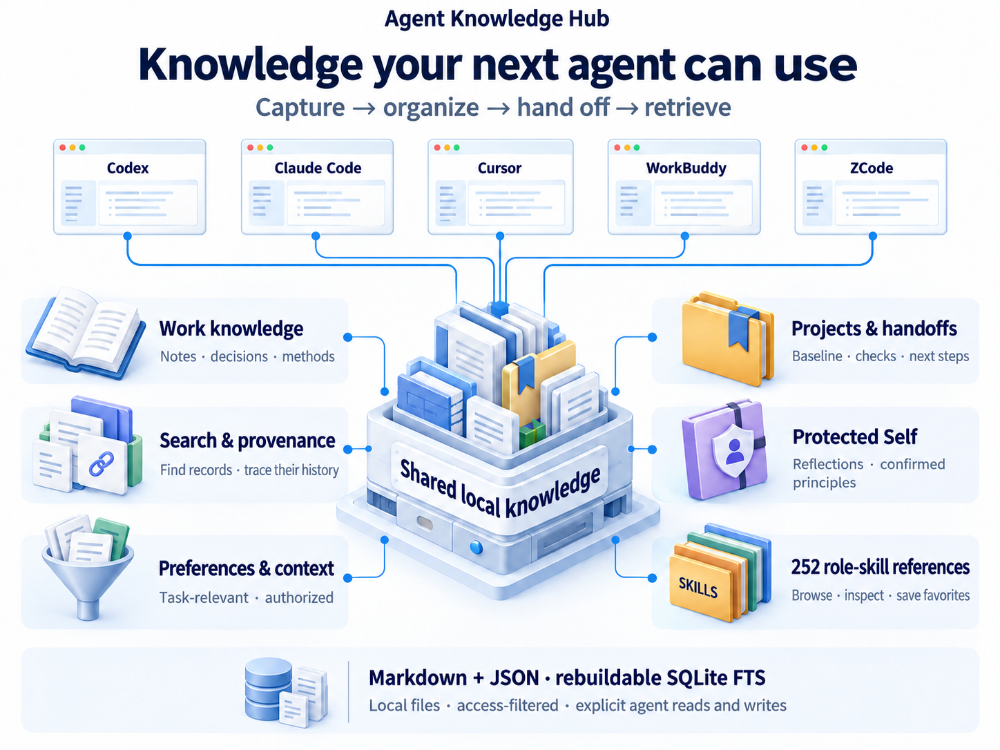
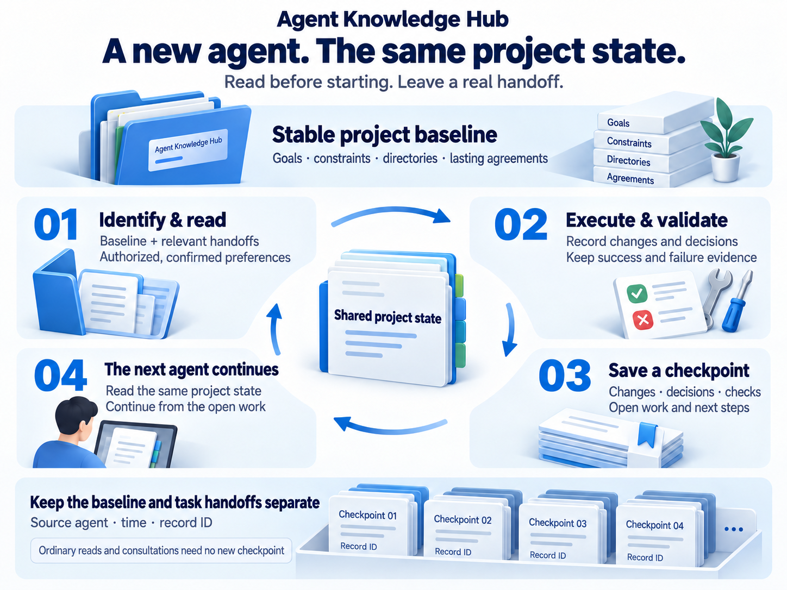
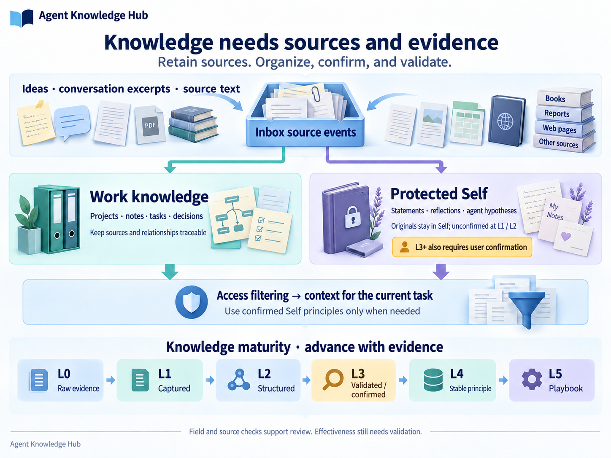

<div align="center">

# Agent Knowledge Hub

### Give the next agent a place to start.

A local knowledge hub over MCP, connecting **knowledge capture, project handoffs, collaboration preferences, and role skills**.

Switch agents, start a new conversation, or return weeks later—with traceable project state to continue from.

[](CHANGELOG.md)
[](mcp_server/requirements.txt)
[](LICENSE.md)

[中文](README.md) · **English**

[Why it matters](#why-a-shared-knowledge-hub-matters) · [Capabilities](#one-hub-eight-connected-capabilities) · [Get started](#get-started) · [Boundaries](#capabilities-and-boundaries)

</div>



## Why a shared knowledge hub matters

Long-running work with agents builds up information you need again: **what changed, why a decision was made, what was actually verified, and what should happen next**.

When that information is scattered across chats, notes, and clients, you become the person who repeatedly reconstructs the handoff. Decisions become hard to find, failed approaches may be repeated, and useful methods remain buried in yesterday's conversation.

Agent Knowledge Hub gives connected MCP clients a shared local source of knowledge. Agents following its workflow read before starting and record a handoff after meaningful changes or validation. Sources remain traceable, conclusions retain their evidence, and personal information has explicit access boundaries. **Work can accumulate into knowledge that later tasks can use.**

| What you want | How the Hub supports it |
|---|---|
| Less repeated project briefing | A stable project identity connects directories, the baseline, decisions, and the latest handoff |
| A clear distinction between done and unverified | Changes, decisions, validation, failures, and open items are recorded separately |
| Experience that helps with the next task | Source material becomes structured knowledge, relationships, and methods with evidence requirements |
| Agents that follow your preferred way of working | They read preferences and principles you have confirmed and shared with them |
| Control of your accumulated knowledge | Records and source events stay in local files you can inspect and back up |

Useful for long-running projects, frequent agent switching, several concurrent projects, and people who want learning and work experience to remain usable over time.

## One hub, eight connected capabilities

| Capability | What is available today | Why it helps |
|---|---|---|
| **Capture and organize knowledge** | Capture ideas, conversation excerpts, and source text through MCP; retain raw Inbox events alongside canonical records | Trace a conclusion back to its source material |
| **Project memory and handoffs** | Resolve a project from its directory, read its stable baseline and relevant handoffs, and record checkpoints | Recover the next step after switching agents or an interruption |
| **Tasks, decisions, and progress** | Record task states and decision rationale; view open / in_progress / blocked / done work across projects | See what needs doing and why the current approach was chosen |
| **Search and relationships** | Keyword, metadata, and SQLite FTS search; links for support, counterevidence, dependencies, replacement, and evolution | Retrieve conclusions and inspect how they developed |
| **Context selected for the task** | Combine authorized project state, handoffs, preferences, work knowledge, and confirmed Self principles; bound body size and return section digests | Supply relevant context while controlling repeated loading |
| **Protected Self Model** | Record reflections, values, principles, and patterns; distinguish user statements from agent inference; require confirmation for L3+ | Preserve personal knowledge with clear access and confirmation states |
| **Shared preferences and optional onboarding** | Use skippable questions about goals and collaboration; save preferences after confirming content and recipient agents | Establish a way of working that fits the user |
| **Role-skill catalog** | Browse, search, and match **252 skill references in 22 categories**; inspect provenance, licensing, and readiness; save per-agent favorites | Discover methods and assess whether they fit the task |

## Project handoffs: continue from the current state



**An illustrative example:** you use Codex to change an API, then ask another connected agent to handle the frontend. With the handoff workflow in place, it can first read:

| Handoff field | Illustrative content, not real user data |
|---|---|
| Project baseline | Goals, constraints, directories, and lasting agreements |
| Changes and decisions | The API changed; old fields were retained for migration |
| Validation and limits | API tests passed; browser regression is still pending |
| Known failure | An older caller still uses an outdated parameter |
| Next step | Update the frontend call and validate it in the browser before release |

The stable baseline is stored separately from each task checkpoint, helping preserve long-term context as new handoffs arrive. Checkpoints retain the source agent, time, and record ID. Reusing a checkpoint key supports deduplication across concurrent retries and recovery after interruption. Ordinary reads and consultations do not need a new checkpoint.

<details>
<summary>Handoff tools</summary>

`resolve_project` / `start_project_session` → execute and validate → `record_project_checkpoint` → the next `start_project_session`.

Use `get_project_timeline` to inspect the history and `list_work_items` for cross-project tasks. Clients must connect to the same Hub and follow the read/write workflow in [SKILL.md](SKILL.md).

</details>

## Knowledge that retains its evidence



**Work** holds projects, knowledge, tasks, decisions, and working methods. **Self** holds personal statements, reflections, observations, and principles. Authorized task context can temporarily combine them while original Self records remain in their protected scope.

| Level | What it means | What it enables |
|---|---|---|
| **L0 · Raw evidence** | A source event in the Inbox | Revisit the original material |
| **L1 · Captured** | A fragment or observation has a canonical record | Retain information before drawing conclusions |
| **L2 · Structured** | Organized knowledge or a testable hypothesis | Retrieve, relate, and investigate it |
| **L3 · Validated / confirmed** | Traceable validation; Self also requires user confirmation | Distinguish hypotheses from confirmed content |
| **L4 · Stable principle** | Adds applicability and evidence of stability | Assess when experience can be reused |
| **L5 · Playbook** | Adds inputs, outputs, steps, failure handling, and validation results | Give an agent a method that can be checked |

The system checks required fields, source readability, and access rights. **Evidence quality and real-world effectiveness still require validation and review.** Agent inferences do not automatically become your established principles, and captured material does not automatically become a reliable L5 playbook.

## Built for knowledge you keep using

**One source across clients.** Data and project identities live in the Hub; clients use them through MCP. The installer has configuration adapters for Codex, Claude Code, Cursor, WorkBuddy, and ZCode, making it easier to reuse knowledge across tools.

**Context has a task and an audience.** Project, record, and Work / Self rules determine what can be returned. Task context supports section digests, so previously delivered, unchanged sections can return a short marker. Character budgets control body size; they are not model-token billing limits.

**Records you can inspect and back up.** Markdown holds canonical records, JSON retains source events, and SQLite FTS is a rebuildable index. You can inspect files, keep backups, and follow provenance and relationships when checking a conclusion.

**Confirmation stays distinct from inference.** Personal hypotheses remain unconfirmed. Shared preferences require agreement on wording and recipient agents. A record has a source, a state, and an intended audience you can examine.

### How it works with tools you already use

| Existing tool | Its role | What the Hub adds |
|---|---|---|
| Chat history | Preserve the full conversation | Project state and knowledge retrievable across sessions |
| `AGENTS.md` / client rules | Define how an agent should work | Record what happened and what was verified |
| Notes / Obsidian | Read, edit, and organize documents | MCP interfaces for access filtering, handoffs, and context |
| Individual skill files | Describe a method for a class of tasks | A catalog, provenance, task matching, and confirmed favorites |

## Find role skills for the task at hand

Describe a task—process documentation, data analysis, sales preparation, design review, or customer support—and look for relevant skill references. The catalog spans **252 skills in 22 categories**, retaining full original text, pinned source versions, licenses, and content hashes.

- **Browse and search:** query by purpose, name, or category, with pagination.
- **Match a task:** receive candidates based on lexical relevance, for you to assess.
- **Inspect before choosing:** review the source, text, dependency clues, and local readiness.
- **Keep favorites:** explicitly confirm additions or removals for the current agent.

Public entries start as **unreviewed external references**. Favoriting does not install dependencies, grant permissions, or execute anything. Preparation still depends on review, readiness, and required dependencies. A new installation does not inherit the author's private knowledge, approved-skill list, or access grants. See the [role-skill guide](references/role-skills.md).

<details>
<summary>Advanced: prepare deliverable drafts that can be checked</summary>

Capability-workflow and role-skill artifact tools can prepare text drafts around “requirements → design → tests” or “process → accountable handoffs → delivery checks,” record artifacts, and check their structure and sources. Required methodologies must first be imported and accessible to the current agent; a fresh installation does not automatically meet those conditions. Structural validation is separate from business execution and still requires review for correctness.

</details>

## What you can say

| Goal | Ask your connected agent |
|---|---|
| Continue a project | “Read this project's state, recent validation, and open items before continuing.” |
| Leave a handoff | “Save these changes, decisions, validation results, and next steps as a project checkpoint.” |
| Retain useful material | “Capture this in the Inbox with its source; keep personal inferences unconfirmed.” |
| Revisit a decision | “Find why we chose this approach and whether later evidence challenged it.” |
| Bound the context | “Load only authorized project records and confirmed preferences relevant to this task.” |
| Choose a method | “Find role skills for process documentation and show candidates and prerequisites first.” |
| Set up collaboration | “Start onboarding with my current goal; ask me before saving a preference.” |

Start with one lasting project: confirm its identity and directory → read its state → complete a small task → record a real handoff → read it from another agent. This directly checks cross-agent continuity.

## Get started

[Download the source](https://github.com/Hanbinai/agent-knowledge-hub/archive/refs/heads/main.zip), extract it, and enter the repository root. Requires **Python 3.11+**. The initialization command below is for a new Hub; skip it for an existing Hub and use that Hub's actual directory.

<details open>
<summary><strong>Windows · PowerShell</strong></summary>

```powershell
python -m venv .venv
& .\.venv\Scripts\python.exe -m pip install -r .\mcp_server\requirements.txt
& .\.venv\Scripts\python.exe .\scripts\init_hub.py --hub "$HOME\KnowledgeHub" --safe-install
.\install.ps1 --hub "$HOME\KnowledgeHub"
```

</details>

<details>
<summary><strong>macOS · Terminal</strong></summary>

```sh
python3 -m venv .venv
.venv/bin/python -m pip install -r mcp_server/requirements.txt
.venv/bin/python scripts/init_hub.py --hub "$HOME/KnowledgeHub" --safe-install
sh install.command --hub "$HOME/KnowledgeHub"
```

</details>

The installer discovers clients from existing configurations and previews changes. Review the preview, then use `--apply --expect` with its fingerprint as described in the [installation guide](references/installation.md#preview-apply-verify). It preserves other connections, backs up original files, and refuses conflicts. Reconnect that MCP connection and ask the agent to call `health_check` to check the version and connectivity.

The Windows installation flow has local machine validation. macOS has configuration fixtures and script validation; **physical macOS acceptance is still pending**. Adapter coverage, conflict handling, and removal are documented in the [installation guide](references/installation.md).

## Capabilities and boundaries

- **Explicit capture:** the public package provides MCP capture and organization tools. Scheduled GET-note synchronization, Drop scanning, and session-end capture need additional scripts and configuration; those automated pipelines are not included here.
- **Retrieval:** current search uses keywords, metadata, and full-text indexing. It does not promise vector semantic retrieval or automatic detection of every contradiction.
- **Local storage and models:** knowledge files stay local. Retrieved content may still enter your client's model context; local storage does not mean all model requests stay on the machine.
- **Access model:** MCP access is filtered by the process-bound agent identity. This is not file encryption or enterprise multi-tenant isolation. Self requires extra authorization; new installations default to Work.
- **Onboarding and sharing:** raw answers remain in the current conversation. Saving a preference requires confirmation of content and audience. Onboarding progress and skill favorites are separate for each agent.
- **Clients and upgrades:** automatic installation requires an existing supported configuration. Claude Desktop and Windsurf do not yet have automatic adapters. Running MCP connections must reconnect to load updated code.

## Explore further

[Installation and removal](references/installation.md) · [Optional onboarding](references/onboarding.md) · [Role skills and licensing](references/role-skills.md) · [Agent workflow](SKILL.md) · [Changelog](CHANGELOG.md)

## License

The Hub software and documentation use [PolyForm Noncommercial 1.0.0](LICENSE.md). Noncommercial use is free. Commercial use requires prior written permission from 寒彬 at `531642103@qq.com`.

The 252 bundled role skills are pinned third-party references: 187 Apache-2.0 and 65 MIT. Their original licenses, copyright notices, and content hashes remain unchanged; the Hub's noncommercial terms do not relicense them. See [Third-party notices](THIRD_PARTY_NOTICE.md).
