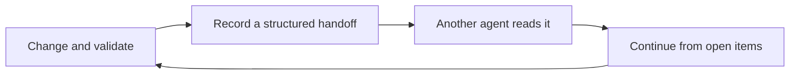

<div align="center">

# Agent Knowledge Hub

**One local project memory for every coding agent.**

Switch agents without repeating the project background, decisions, validations, and unfinished work.

[](CHANGELOG.md)
[](mcp_server/requirements.txt)
[](references/installation.md)
[](LICENSE.md)

[中文](README.md) · **English**

</div>


## The problem it solves

When several coding agents are used on the same project, context is often trapped in separate chats. Agent Knowledge Hub keeps the project baseline, handoffs, and optional skills in one local store, so the next agent can continue from the current state.

| Without a shared hub | With Agent Knowledge Hub |
|---|---|
| Each agent remembers only its own chat | The project has one baseline and latest handoff |
| Switching tools means explaining the work again | The next agent reads the current state and open items |
| Skills are scattered across client directories | 252 role skills can be browsed, searched, and favorited |
| Personal information mixes with project records | Work and personal memory use separate permissions |

## How work continues



Each handoff records the changes, decisions, validations, unfinished work, source agent, and time. Readers receive record IDs, so later work can be traced instead of relying on an unattributed summary.

## Core capabilities

| Capability | Development benefit |
|---|---|
| Client discovery | No hand-written connection for every agent; preview first, then confirm |
| Cross-agent handoff | Continue after switching agents without losing context |
| Optional onboarding | Build collaboration preferences from the user's goal, without an occupation questionnaire |
| 252 role skills | Browse and search by task, then save confirmed favorites for the current agent |
| Provenance and permissions | Separate work memory, personal memory, user statements, and agent inferences |

## Quick start

Requires Python 3.11 or newer. The Windows flow has been tested on a physical machine. The macOS flow has configuration fixtures and shell validation, but has not yet been accepted on physical macOS hardware.

Windows PowerShell:

```powershell
python -m venv .venv
& .\.venv\Scripts\python.exe -m pip install -r .\mcp_server\requirements.txt
& .\.venv\Scripts\python.exe .\scripts\init_hub.py --hub "$HOME\KnowledgeHub" --safe-install
.\install.ps1 --hub "$HOME\KnowledgeHub"
```

macOS Terminal:

```sh
python3 -m venv .venv
.venv/bin/python -m pip install -r mcp_server/requirements.txt
.venv/bin/python scripts/init_hub.py --hub "$HOME/KnowledgeHub" --safe-install
sh install.command --hub "$HOME/KnowledgeHub"
```

The installer discovers clients only from existing standard configuration files. It previews each change, preserves unrelated connections, and refuses conflicts instead of silently overwriting them. See the [installation guide](references/installation.md).

## What you can say

- “Start onboarding” to answer a few questions about your goal and preferred way of working.
- “Browse role skills” to page through 252 skills in 22 categories.
- “Find a skill for process documentation” to match the current task without occupation stereotypes.
- “Save this skill as a favorite” or “Remove this favorite”; the confirmed choice belongs only to the current agent.

A favorite does not install dependencies, call external services, or grant execution permission. Preparation still checks provenance, content, and access. See the [role-skill guide](references/role-skills.md).

## Boundaries

- An open client must reconnect before it loads a new version.
- Raw onboarding answers stay in the current conversation unless a preference is explicitly confirmed.
- A local hub does not mean model requests never leave the machine.
- A missing configuration is not permission to invent and write one.
- Claude Desktop and Windsurf do not yet have automatic adapters.

## License

The Hub software and documentation use [PolyForm Noncommercial 1.0.0](LICENSE.md). Noncommercial use is free. Commercial use requires prior written permission from 寒彬 at `531642103@qq.com`.

The 252 bundled role skills are pinned third-party references: 187 Apache-2.0 and 65 MIT. Their original licenses, copyright notices, and content hashes remain unchanged. See [Third-party notices](THIRD_PARTY_NOTICE.md).
