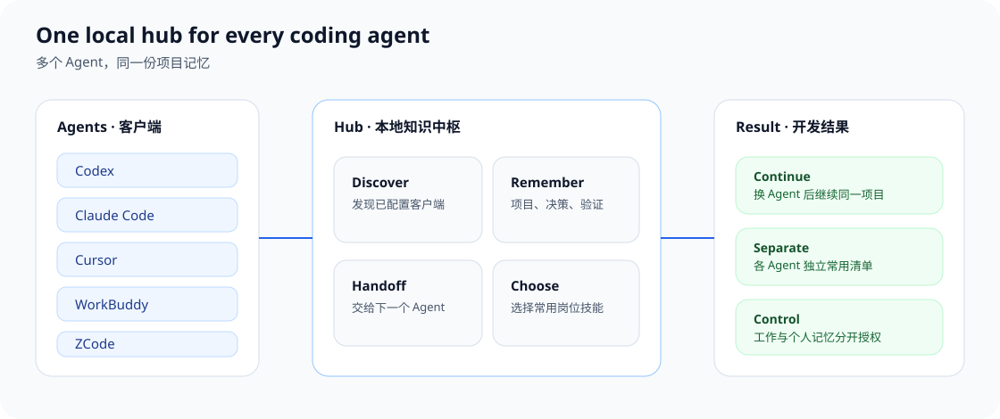
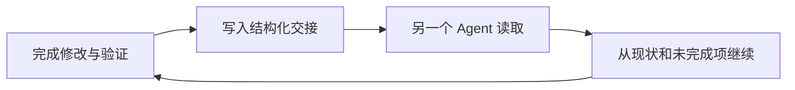

<div align="center">

# Agent Knowledge Hub

**让每个编码 Agent 使用同一份本地项目记忆。**

换一个 Agent，也不必从头重复项目背景、决策、验证和未完成事项。

[](CHANGELOG.md)
[](mcp_server/requirements.txt)
[](references/installation.md)
[](LICENSE.md)

**中文** · [English](README.en.md)

</div>



## 它解决什么问题

同时使用多个编码 Agent 时，项目背景常常散落在不同对话里。Agent Knowledge Hub 把项目现状、交接记录和可选技能放在你的电脑本地，让下一个 Agent 从当前进度继续，而不是让你重新说明一遍。

| 没有共享知识中枢 | 接入 Hub 之后 |
|---|---|
| 每个 Agent 只记得自己的对话 | 同一项目共享稳定背景和最新交接 |
| 换工具后重复描述目标与限制 | 新 Agent 先读取现状和未完成项 |
| 技能散落在各个客户端目录 | 252 个岗位技能可浏览、搜索并选择常用 |
| 个人内容容易混进项目记录 | 工作记忆与个人记忆分开授权 |

## 一次开发交接如何延续



每次交接都保留修改、决策、验证和未完成项，并记录来源 Agent 与时间。读取时返回记录编号，方便以后核对，而不是只留下一段无法追溯的摘要。

## 核心能力

| 能力 | 给开发带来的便利 |
|---|---|
| 自动发现客户端 | 不需要手写每个 Agent 的连接配置；先预览，再确认写入 |
| 跨 Agent 项目交接 | 换 Agent 后直接继续，减少重复说明和上下文丢失 |
| 可选入门问答 | 按你的目标和场景建立协作方式，不套用固定职业问卷 |
| 252 个岗位技能 | 按任务浏览和搜索，确认后加入当前 Agent 的常用清单 |
| 权限与来源 | 区分工作记忆、个人记忆、用户原话和 Agent 推断 |

## 三分钟上手

需要 Python 3.11 或更高版本。Windows 已完成实际安装验证；macOS 已完成配置模拟，尚未完成苹果电脑实机验收。

Windows PowerShell：

```powershell
python -m venv .venv
& .\.venv\Scripts\python.exe -m pip install -r .\mcp_server\requirements.txt
& .\.venv\Scripts\python.exe .\scripts\init_hub.py --hub "$HOME\KnowledgeHub" --safe-install
.\install.ps1 --hub "$HOME\KnowledgeHub"
```

macOS Terminal：

```sh
python3 -m venv .venv
.venv/bin/python -m pip install -r mcp_server/requirements.txt
.venv/bin/python scripts/init_hub.py --hub "$HOME/KnowledgeHub" --safe-install
sh install.command --hub "$HOME/KnowledgeHub"
```

安装器只根据已有的标准配置文件发现客户端。它会先展示将要修改的项目，保留其他连接配置；遇到冲突时拒绝覆盖，不会静默改写。完整规则见[安装指南](references/installation.md)。

## 使用时可以这样说

- “开始引导”：用几轮问题了解你的目标、场景和希望 AI 如何配合。
- “查看岗位技能”：分页浏览 22 类、252 个岗位技能。
- “找适合写流程文档的技能”：按当前任务匹配，不根据职业做刻板推荐。
- “把这个技能设为常用”或“取消常用”：确认后只保存到当前 Agent。

收藏技能不会自动安装依赖、调用外部服务或授予执行权限。真正使用前，仍要经过来源、内容和权限检查。更多说明见[岗位技能指南](references/role-skills.md)。

## 使用边界

- 已打开的客户端需要重新连接后，才会加载新版本。
- 入门问答的原始回答默认留在当前对话中，不会自动写入知识库。
- 本地知识库不等于所有对话都不出网；内容仍会进入客户端所使用模型的上下文。
- 没有配置文件的新客户端不会被猜测路径后自动写入。
- Claude Desktop 与 Windsurf 当前没有自动适配器。

## 许可证

Hub 软件与文档使用 [PolyForm Noncommercial 1.0.0](LICENSE.md)：非商业使用免费；商业使用请联系 `531642103@qq.com` 取得书面授权。

`public/role-skills/` 中的 252 个技能是第三方固定快照，其中 187 个使用 Apache-2.0，65 个使用 MIT。它们保留原许可证、版权声明和内容校验值，不受 Hub 的非商业条款重新授权。详见[第三方声明](THIRD_PARTY_NOTICE.md)。
