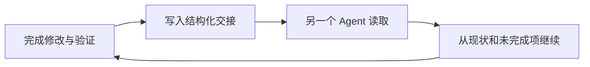
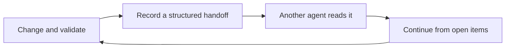

<div align="center">

# Agent Knowledge Hub

**One local memory for every coding agent.**

换一个 Agent，也不必从头重复项目背景、决策、验证和未完成事项。

[](CHANGELOG.md)
[](mcp_server/requirements.txt)
[](references/installation.md)
[](LICENSE.md)

[中文介绍](#中文介绍) · [English](#english) · [安装](references/installation.md) · [岗位技能](references/role-skills.md)

</div>


---

## 中文介绍

Agent Knowledge Hub 是一个运行在你自己电脑上的 MCP 知识中枢。Codex、Claude Code、Cursor、WorkBuddy、ZCode 可以连接同一份项目记忆，而不是各自保存一份会逐渐过时的聊天记录。

它适合同时使用多个编码 Agent 的开发者：一个 Agent 写完代码，另一个 Agent 不需要你重新说明“改了什么、验证了什么、下一步是什么”。

### 没有它，和有它

| 普通的多 Agent 协作 | 接入 Hub 之后 |
|---|---|
| 每个 Agent 只记得自己的对话 | 同一项目共享稳定背景和最新交接 |
| 换工具后重复描述目标与限制 | 新 Agent 先读取项目现状和未完成项 |
| 技能散落在各客户端目录 | 252 个岗位技能可浏览、搜索并选择常用 |
| 个人内容容易混进项目记录 | 工作记忆与个人记忆分开授权 |

### 一次开发交接如何延续



每次交接都保留修改、决策、验证和未完成项，并记录来源 Agent 与时间。读取时返回记录 ID，方便以后核对，而不是只留下一段无法追溯的摘要。

### 核心能力

| 能力 | 对开发的便利 |
|---|---|
| 自动发现客户端 | 不需要手写每个 Agent 的 MCP 配置；先预览，再确认写入 |
| 跨 Agent 项目交接 | 换 Agent 后直接继续，减少重复说明和上下文丢失 |
| 可选入门问答 | 新用户用自己的目标和场景建立协作方式，不套用固定职业问卷 |
| 252 个岗位技能 | 按任务浏览和搜索，确认后加入当前 Agent 的常用清单 |
| 权限与来源 | 区分工作记忆、个人记忆、用户原话和 Agent 推断 |

### 三分钟上手

环境要求：Python 3.11 或更高版本。Windows 已完成实际安装验证；macOS 已完成配置模拟，尚未完成苹果电脑实机验收。

Windows PowerShell：

```powershell
python -m venv .venv
& .\.venv\Scripts\python.exe -m pip install -r .\mcp_server\requirements.txt
& .\.venv\Scripts\python.exe .\scripts\init_hub.py --hub "$HOME\KnowledgeHub" --safe-install
.\install.ps1 --hub "$HOME\KnowledgeHub"
```

macOS Terminal：

```sh
python3 -m venv .venv
.venv/bin/python -m pip install -r mcp_server/requirements.txt
.venv/bin/python scripts/init_hub.py --hub "$HOME/KnowledgeHub" --safe-install
sh install.command --hub "$HOME/KnowledgeHub"
```

安装器只根据已有的标准配置文件发现客户端。它会先展示将要修改的项目，保留其他 MCP 配置；遇到冲突时拒绝覆盖，不会静默改写。

### 使用时可以这样说

- “开始引导”：用几轮问题了解你的目标、场景和希望 AI 如何配合。
- “查看岗位技能”：分页浏览 22 类、252 个岗位技能。
- “找适合写流程文档的技能”：按当前任务匹配，不根据职业做刻板推荐。
- “把这个技能设为常用”或“取消常用”：确认后只保存到当前 Agent。

收藏技能不会自动安装依赖、调用外部服务或授予执行权限。真正使用前，仍要经过来源、内容和权限检查。

### 明确边界

- 已打开的客户端需要重新连接 MCP，才会加载新版本。
- 原始入门回答默认留在当前对话中，不会自动写入知识库。
- 本地知识库不等于所有对话都不出网；内容仍会进入客户端所使用模型的上下文。
- 没有配置文件的新客户端不会被猜测路径后自动写入。
- Claude Desktop 与 Windsurf 当前没有自动适配器。

### 许可证

Hub 软件与文档使用 [PolyForm Noncommercial 1.0.0](LICENSE.md)：非商业使用免费；商业使用请联系 `531642103@qq.com` 取得书面授权。

`public/role-skills/` 中的 252 个技能是第三方固定快照，其中 187 个使用 Apache-2.0，65 个使用 MIT。它们保留原许可证、版权声明和内容哈希，不受 Hub 的非商业条款重新授权。

---

## English

Agent Knowledge Hub is a local MCP knowledge service for developers who work with more than one coding agent. Instead of repeating project context in every new chat, connected agents read the same project baseline, latest handoff, decisions, validations, and open items.

### Why it is useful

| Without a shared hub | With Agent Knowledge Hub |
|---|---|
| Context lives in separate conversations | Project context lives in one local store |
| Switching agents means explaining everything again | The next agent starts from the latest handoff |
| Skills are scattered across client directories | 252 role skills can be browsed and favorited |
| Personal and project information get mixed | Work and personal scopes have separate permissions |

### The handoff loop



A handoff records what changed, which decisions were made, how the result was validated, and what remains unfinished. It also preserves the source agent and timestamp.

### Core capabilities

- **Client discovery:** Finds supported clients from their existing configuration files, previews every change, and refuses conflicts instead of overwriting them.
- **Cross-agent continuity:** Shares project facts and handoffs without copying private chat histories.
- **Optional onboarding:** Asks one or two adaptive questions at a time about the user's goal and preferred collaboration style. Occupation is optional.
- **Role-skill catalog:** Provides 252 pinned skills across 22 categories, with search, task matching, and explicit favorites.
- **Provenance and permissions:** Separates user statements from agent inferences, and work information from protected personal information.


### Quick start

Requires Python 3.11 or newer. The Windows installation flow has been tested on a physical machine. The macOS flow has configuration fixtures and shell validation, but has not yet been accepted on physical macOS hardware.

Windows PowerShell:

```powershell
python -m venv .venv
& .\.venv\Scripts\python.exe -m pip install -r .\mcp_server\requirements.txt
& .\.venv\Scripts\python.exe .\scripts\init_hub.py --hub "$HOME\KnowledgeHub" --safe-install
.\install.ps1 --hub "$HOME\KnowledgeHub"
```

macOS Terminal:

```sh
python3 -m venv .venv
.venv/bin/python -m pip install -r mcp_server/requirements.txt
.venv/bin/python scripts/init_hub.py --hub "$HOME/KnowledgeHub" --safe-install
sh install.command --hub "$HOME/KnowledgeHub"
```

The installer never scans arbitrary disks or private chats. It recognizes Codex, Claude Code, Cursor, WorkBuddy, and ZCode only when their documented configuration files already exist. See the [installation guide](references/installation.md) for backups, idempotency, and removal behavior.

### Natural-language use

Say “start onboarding” to begin the optional introduction. Say “browse role skills” to page through the catalog, or describe a task such as “find a skill for process documentation.” Favorites are saved only after an explicit confirmation and belong to the current agent.

Adding a favorite does not install dependencies, enable external tools, or grant execution permission. Skill text is treated as untrusted reference material.

### Boundaries

- A running client must reconnect its MCP server before new tools appear.
- Onboarding answers remain in the conversation unless the user explicitly confirms a preference.
- A local hub does not mean that model requests never leave the machine.
- Missing client configuration is not treated as permission to invent and write one.
- Claude Desktop and Windsurf do not yet have automatic adapters.

### License

The Hub software and documentation are licensed under [PolyForm Noncommercial 1.0.0](LICENSE.md). Noncommercial use is free. Commercial use requires prior written permission from 寒彬 at `531642103@qq.com`.

The 252 bundled role skills remain under their original licenses: 187 Apache-2.0 and 65 MIT. Their license files, copyright notices, and content hashes are preserved. See [Third-party notices](THIRD_PARTY_NOTICE.md).
