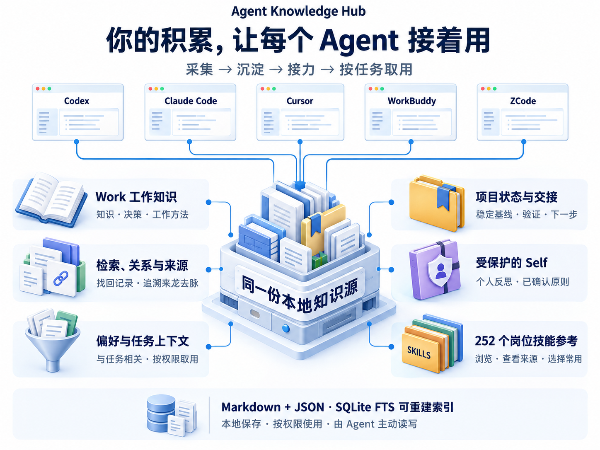
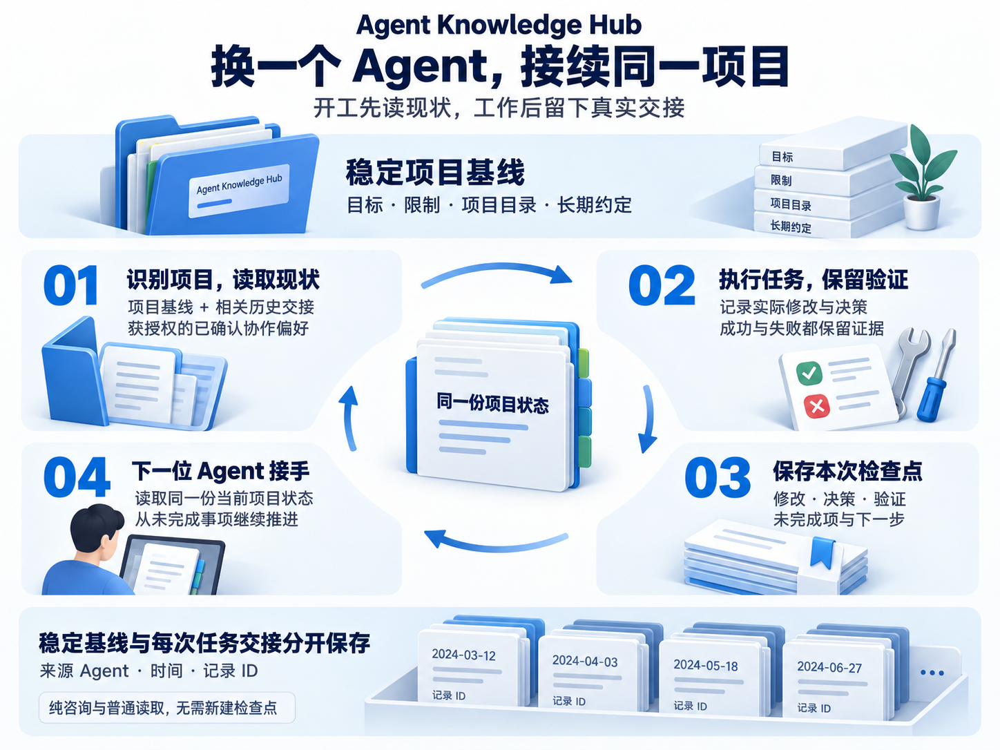
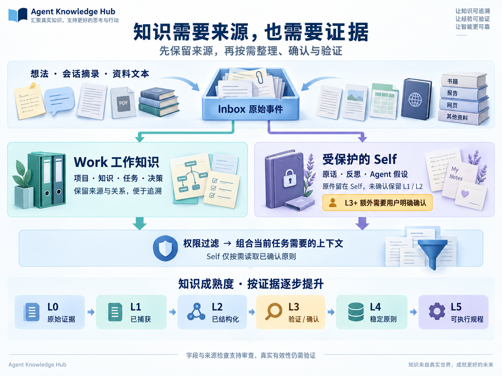

<div align="center">

# Agent Knowledge Hub

### 让 Agent 的每一次工作，成为下一次工作的起点。

基于 MCP 的本地知识中枢，把**知识沉淀、项目接力、协作偏好和岗位技能**连接起来。

换 Agent、换会话、隔一段时间再回来，仍能从有来源、有验证的项目状态继续。

[](CHANGELOG.md)
[](mcp_server/requirements.txt)
[](LICENSE.md)

**中文** · [English](README.en.md)

[了解价值](#为什么需要一个共享知识中枢) · [完整能力](#一套中枢连接八项能力) · [开始使用](#开始使用) · [使用边界](#能力与使用边界)

</div>



## 为什么需要一个共享知识中枢

长期使用 Agent，真正需要持续积累的，是**做过什么、为什么这样做、验证到了哪一步，以及接下来该怎么继续**。

这些信息散落在聊天记录、临时笔记和不同客户端里时，你就要反复充当项目的“交接人”。重要决策难找，失败方案可能被重做，某次任务学到的方法也很难在下一次被用上。

Agent Knowledge Hub 为接入的 MCP 客户端提供同一份本地知识源。Agent 按协议在开工时读取、在实际修改或验证后留下交接；资料保留来源，结论保留证据，个人内容按权限使用。**工作的结果可以沉淀下来，后续任务可以接着用。**

| 你关心的结果 | Hub 如何支持 |
|---|---|
| 少重复交代项目背景 | 用稳定项目身份关联目录、基线、历史决策和最新交接 |
| 知道哪里已完成、哪里还没验证 | 将修改、决策、验证、失败和未完成项分别记录 |
| 经验能在下次任务派上用场 | 把来源材料整理为知识、关系和有证据门槛的方法 |
| Agent 更符合你的协作方式 | 读取你已确认、明确共享给它的偏好与原则 |
| 换客户端仍掌握自己的积累 | 正式记录和来源保存在本地，可直接查看和备份 |

尤其适合长期维护项目、经常切换 Agent、同时管理多个项目，以及希望持续积累学习和工作经验的人。

## 一套中枢，连接八项能力

| 能力 | 当前可以做什么 | 对使用者的价值 |
|---|---|---|
| **知识采集与沉淀** | 通过 MCP 保存想法、会话摘录和资料文本；原始事件进入 Inbox，再整理为正式记录 | 原始材料与整理后的结论都有迹可循 |
| **项目记忆与接力** | 按目录识别项目，读取稳定基线和相关历史交接；保存新的检查点 | 更换 Agent 或中断后，可以找回下一步 |
| **任务、决策与进展** | 记录任务状态、决策理由；跨项目查看 open / in_progress / blocked / done 工作项 | 同时看清“要做什么”和“为什么这样做” |
| **检索与知识关系** | 关键词、元数据和 SQLite FTS 全文检索；关联支持、反例、依赖、替代与演化关系 | 找回结论，也能追溯它的来源和变化 |
| **按任务组织上下文** | 按权限组合项目、交接、偏好、工作知识和已确认 Self 原则；限制正文字符量，支持分区摘要增量返回 | 把当前任务相关的信息交给 Agent，控制重复加载 |
| **受保护的 Self Model** | 记录个人反思、价值观、原则与行为模式；区分用户原话和 Agent 推断，确认后才能进入 L3+ | 保留个人知识，同时明确谁能读、哪些内容仍是假设 |
| **共享偏好与可选引导** | 用可跳过的问答了解目标与协作方式；确认具体内容和接收 Agent 后保存偏好 | 逐步建立适合你的合作方式 |
| **岗位技能目录** | 浏览、搜索和按任务匹配 **22 类、252 个技能参考**；查看来源、许可证和审核状态，保存当前 Agent 的常用清单 | 发现可借鉴的方法，并判断是否适合当前任务 |

## 项目接力：下一位 Agent 从当前状态开始



**一个使用示例：**你先用 Codex 修改接口，再让另一个已接入 Hub 的 Agent 接手前端。遵循接力协议后，它可以先读到：

| 交接内容 | 示例，非真实用户数据 |
|---|---|
| 项目基线 | 目标、限制、项目目录和长期约定 |
| 本次修改与决策 | 接口已调整；保留旧字段以支持迁移 |
| 验证及限制 | 接口测试通过；浏览器端尚未回归 |
| 已知失败 | 某个旧调用仍使用过期参数 |
| 下一步 | 更新前端调用，完成浏览器验证后再发布 |

稳定基线与每次任务的检查点分开保存，减少新交接覆盖长期背景的问题。检查点保留来源 Agent、时间和记录 ID；重试使用同一个键，支持并发去重与中断恢复。纯咨询和普通读取不需要生成新的交接记录。

<details>
<summary>查看接力工具</summary>

`resolve_project` / `start_project_session` → 执行与验证 → `record_project_checkpoint` → 下一次 `start_project_session`。

需要追溯过程时使用 `get_project_timeline`；查看跨项目待办时使用 `list_work_items`。客户端需连接同一 Hub，并遵循 [SKILL.md](SKILL.md) 中的读写协议。

</details>

## 知识沉淀：从“记下来”到“有依据地复用”



**Work** 保存项目、知识、任务、决策和工作方法；**Self** 保存个人原话、反思、观察和原则。两者可以在获授权的任务上下文中临时组合，Self 原件仍留在受保护的域内。

| 阶段 | 表示什么 | 何时有用 |
|---|---|---|
| **L0 · 原始证据** | Inbox 中的来源事件 | 保留最初材料，便于回看 |
| **L1 · 已捕获** | 片段或观察已成为正式记录 | 先留住信息，不急于下结论 |
| **L2 · 已结构化** | 已整理的知识或可检验假设 | 便于查找、关联和继续验证 |
| **L3 · 已验证 / 确认** | 有可追溯验证依据；Self 还需用户明确确认 | 区分假设与已确认内容 |
| **L4 · 稳定原则** | 增加适用范围与稳定性证据 | 判断何时可以复用一条经验 |
| **L5 · 可执行规程** | 增加输入、输出、步骤、失败处理和验证结果 | 给 Agent 提供可检查的操作方法 |

系统检查晋级字段、来源可读性和权限；**材料是否充分、方法是否有效，仍需要真实验证和审查**。Agent 推断不会自动成为你的稳定原则，已有材料也不会自动被包装成可靠的 L5 方法。

## 为什么它适合长期使用

**一份知识源，多种客户端。** 数据和项目身份留在 Hub，客户端通过 MCP 使用它们。安装器已适配 Codex、Claude Code、Cursor、WorkBuddy、ZCode 的配置结构，便于在多个工具间复用积累。

**每次读取都有任务和权限边界。** 项目、记录、Work / Self 权限共同决定哪些内容可返回。上下文按任务组织，已送达且未变化的分区可只返回摘要标记；字符预算用于控制正文体积，不等同于模型 token 计费上限。

**可追溯、可检查、可备份。** Markdown 保存正式记录，JSON 保留来源事件，SQLite FTS 是可重建索引。知识可以直接检查和备份，结论可以沿来源与关系继续核对。

**把确认与猜测分开。** 个人推断留在未确认阶段；共享偏好需要确认表述与共享对象。你可以理解一条记录为何存在、处于什么状态、会被谁使用。

### 与现有工具如何配合

| 已有工具 | 继续负责 | Hub 补充的部分 |
|---|---|---|
| 聊天记录 | 保存完整对话 | 提炼可跨会话取用的项目状态和正式知识 |
| `AGENTS.md` / 客户端规则 | 约定 Agent 如何工作 | 记录项目实际发生了什么、验证到哪一步 |
| 笔记工具 / Obsidian | 阅读、编辑和整理文档 | 通过 MCP 提供权限过滤、接力和上下文接口 |
| 单独的技能文件 | 描述一类任务的方法 | 提供目录、来源、任务匹配和受确认的常用清单 |

## 252 个岗位技能，按当前任务查找

写流程文档、分析数据、准备销售材料、开展设计评审或处理客户支持时，可以先描述任务，再查询适用的技能参考。目录覆盖 **22 类、252 个技能**，保留完整原文、固定来源版本、许可证和内容校验值。

- **浏览与搜索：**按用途、名称或类别查看，支持分页。
- **任务匹配：**按任务词汇相关性返回候选；匹配结果供选择，不保证最佳答案。
- **查看后再决定：**阅读来源、正文、依赖线索和本地审核状态。
- **保存常用：**明确确认后，添加或移除当前 Agent 的常用条目。

公共目录条目默认是**未审核的外部参考**。收藏不会安装依赖、授予权限或开始执行；实际准备使用仍受审核、可用性和依赖条件约束。新安装不会继承作者的私人知识、已审核清单或访问授权。详见[岗位技能指南](references/role-skills.md)。

<details>
<summary>进阶：把方法变成可核对的交付草稿</summary>

服务还提供能力工作流与角色技能产物接口：按“需求 → 设计 → 测试”或“流程 → 责任交接 → 交付检查”准备文本草稿，保存产物并检查结构及来源。使用前，需要相关方法已导入且当前 Agent 有权限；新安装不会自动满足这些条件。结构校验通过不代表业务执行完成，内容正确性仍需审查。

</details>

## 使用时可以这样说

| 你的目标 | 对已接入的 Agent 说 |
|---|---|
| 接续一个长期项目 | “先读取这个项目的现状、最近验证和未完成项，再继续。” |
| 完成一次交接 | “把这次修改、决策、验证结果和下一步保存为项目检查点。” |
| 沉淀重要材料 | “把这段内容收进 Inbox，保留来源；个人推断先不要确认。” |
| 追溯一个决定 | “找出当时为什么选这个方案，以及后续有没有反例。” |
| 控制上下文范围 | “只加载当前任务相关、我有权限使用的项目记录和已确认偏好。” |
| 选择方法 | “找适合写流程文档的岗位技能，先展示候选和使用条件。” |
| 建立协作方式 | “开始引导，先了解我这次的目标；需要保存时先让我确认。” |

首次使用可以从一个长期项目开始：确认项目与目录 → 读取项目状态 → 完成一项小任务 → 保存一次真实交接 → 在另一个 Agent 中读取。这能直接检验跨 Agent 连续性。

## 开始使用

先[下载源码](https://github.com/Hanbinai/agent-knowledge-hub/archive/refs/heads/main.zip)，解压并进入仓库根目录。需要 **Python 3.11+**。下面的初始化命令适用于新 Hub；已有 Hub 请跳过初始化并使用它的真实目录。

<details open>
<summary><strong>Windows · PowerShell</strong></summary>

```powershell
python -m venv .venv
& .\.venv\Scripts\python.exe -m pip install -r .\mcp_server\requirements.txt
& .\.venv\Scripts\python.exe .\scripts\init_hub.py --hub "$HOME\KnowledgeHub" --safe-install
.\install.ps1 --hub "$HOME\KnowledgeHub"
```

</details>

<details>
<summary><strong>macOS · Terminal</strong></summary>

```sh
python3 -m venv .venv
.venv/bin/python -m pip install -r mcp_server/requirements.txt
.venv/bin/python scripts/init_hub.py --hub "$HOME/KnowledgeHub" --safe-install
sh install.command --hub "$HOME/KnowledgeHub"
```

</details>

安装器根据已有配置发现客户端，先展示变更。检查预览后，按[安装指南](references/installation.md#preview-apply-verify)使用 `--apply --expect` 和本次预览指纹应用配置。它保留其他连接、备份原文件并拒绝冲突。然后重连对应 MCP，在 Agent 中调用 `health_check` 检查版本和连接。

Windows 安装流程已有本机验证；macOS 已有配置样本与脚本验证，**尚未完成真机验收**。客户端配置适配范围、冲突处理及卸载方式见[安装指南](references/installation.md)。

## 能力与使用边界

- **主动采集：**公开包提供 MCP 采集和整理接口；GET 笔记定时同步、Drop 文件扫描和会话结束自动采集需要额外脚本与配置，本公开包未附带这些自动化流程。
- **检索方式：**当前使用关键词、元数据与全文索引；不承诺向量语义检索或自动发现所有矛盾。
- **本地与模型：**知识文件保存在本地；被读取的内容仍可能进入客户端所用模型的上下文。本地 Hub 不代表模型请求永不出网。
- **权限范围：**MCP 权限按进程绑定的 Agent 身份过滤，不是文件加密或企业多租户隔离。Self 访问需额外授权；新安装默认 Work。
- **引导与共享：**原始问答留在当前对话中。保存偏好须确认内容和共享对象；入门进度与技能常用清单按 Agent 分别保存。
- **客户端与升级：**自动安装依赖已有标准配置；Claude Desktop、Windsurf 暂无自动适配器。更新磁盘代码后，已打开的 MCP 连接需要重连。

## 进一步了解

[安装与回退](references/installation.md) · [可选入门引导](references/onboarding.md) · [岗位技能与许可](references/role-skills.md) · [Agent 工作协议](SKILL.md) · [版本记录](CHANGELOG.md)

## 许可证

Hub 软件与文档使用 [PolyForm Noncommercial 1.0.0](LICENSE.md)：非商业使用免费；商业使用请联系 `531642103@qq.com` 取得书面授权。

`public/role-skills/` 中的 252 个技能是第三方固定快照，其中 187 个使用 Apache-2.0，65 个使用 MIT。它们保留原许可证、版权声明和内容校验值，不受 Hub 的非商业条款重新授权。详见[第三方声明](THIRD_PARTY_NOTICE.md)。
